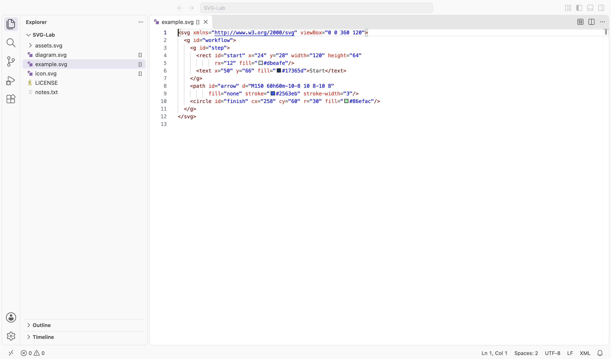
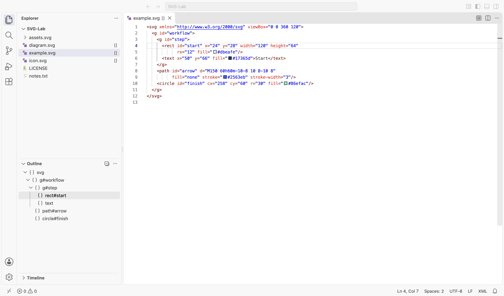

# 第一部分 · VS Code 扩展（A.3）

## 宿主与扩展如何协作

VS Code 管理窗口、文件操作、已打开的文档和扩展生命周期。[扩展入口](../../vscode-extension/src/extension.ts)在激活时注册两个 provider，并把注册句柄交给扩展上下文释放。清单使用 `onStartupFinished`，因此只浏览文件夹时也能看到标记；打开 XML 文本文档也可触发激活。

- **资源管理器**向[文件装饰 provider](../../vscode-extension/src/decoration.ts)传入 URI。扩展检查后缀，再用宿主的 `workspace.fs.stat` 检查文件类型，从而排除名为 `assets.svg` 的目录。VS Code 负责绘制 `[]`、处理重命名以及应用当前主题。
- **大纲**向[文档符号 provider](../../vscode-extension/src/symbols.ts)传入当前文本缓冲区。[解析函数](../../vscode-extension/src/outline.ts)根据元素嵌套生成有序树，保留根 `svg`，这样可以从大纲定位整幅图；有 id 时显示 `标签#id`。provider 把源码偏移映射为 `DocumentSymbol` 的完整范围与开始标签选区。宿主负责树视图、点击跳转和编辑后的重新查询。解析遇到不完整标签时返回空树，下一次有效编辑即可恢复。

## 文件装饰、Decorator 与 Adapter

经典 Decorator 持有一个实现相同接口的对象，在转发调用前后附加行为。文件标记也给既有对象增加了可见信息，但这里的组合由 Explorer 完成。扩展只按 URI 提供独立的装饰数据，文件对象与原始内容均由宿主管理。

Adapter 的作用是把一种接口或数据表示转换成调用方期待的形式。本扩展中，符号 provider 将带源码偏移的 XML 元素树转换为 VS Code 的符号树，是适配关系。文件装饰 provider 同样遵循宿主接口，其呈现效果由宿主把返回的 badge 叠加到文件行上。

## Phase 1 复用评估

| 现有实现 | 在扩展中的取舍 |
|---|---|
| [Shape](../../src/domain/Shape.ts)、[Group](../../src/domain/Group.ts)、[Document](../../src/domain/Document.ts) | 父子结构和有序遍历可以复用。领域模型还要求图形 id、维护文档索引，且缺少源码位置。大纲直接遍历 XML DOM，既保留匿名元素，也能显示模型未收录的标签。 |
| [SvgReader.parse](../../src/io/SvgReader.ts) | 沿用同一个 XML 解析库以及从根向下遍历的方法。CLI 导入会补 id、过滤未知图形，并把节点变成领域对象；大纲需要原名和精确位置，因此单独保留 DOM 元素位置。 |
| [Command](../../src/command/Command.ts)、[CommandHistory](../../src/command/CommandHistory.ts)、[Repl](../../src/cli/Repl.ts) | 负责执行 CLI 命令、管理撤销记录和处理终端输入。两个 provider 都是只读查询；文本编辑、撤销与文档版本由 VS Code 负责。 |
| [FileSystemPort](../../src/io/FileSystemPort.ts) | Phase 1 的端口提供按路径读写文本。文件装饰需要查询 URI 类型，大纲需要包含未保存编辑的文本，因此分别使用宿主的 `workspace.fs.stat` 和 `TextDocument.getText()`。 |

## 运行示例

### 验收记录

在 macOS 的独立 VS Code 1.144.0 配置中安装了打包后的 `svg-editor-lab.svg-editor-outline@0.1.0`。以文本编辑器打开示例，得到以下结果。

| 操作 | 实际结果 |
|---|---|
| 同时列出三份 SVG、`assets.svg` 目录、`notes.txt` 与 `LICENSE` | 三份 SVG 显示 `[]`；目录、文本文件及无扩展名文件均无标记。 |
| 把 `icon.svg` 改名为 `icon.txt`，再改回 | 标记随改名消失、恢复；换成深色主题并关闭文件图标后，三份 SVG 仍显示标记。 |
| 展开两个嵌套分组，点击 `rect#start` | 同级匿名节点显示为 `text`，点击矩形后光标定位到第 4 行第 7 列。 |
| 在未保存的缓冲区修改矩形 id 并插入子分组 | 大纲显示 `rect#verify` 和 `g#new`；删除一个结束标签后大纲清空，恢复有效内容后大纲重新出现。 |
| 在禁用该扩展的独立窗口打开同一示例 | 文件标记消失，原生大纲提示示例中没有符号。 |
